<p align="center">
  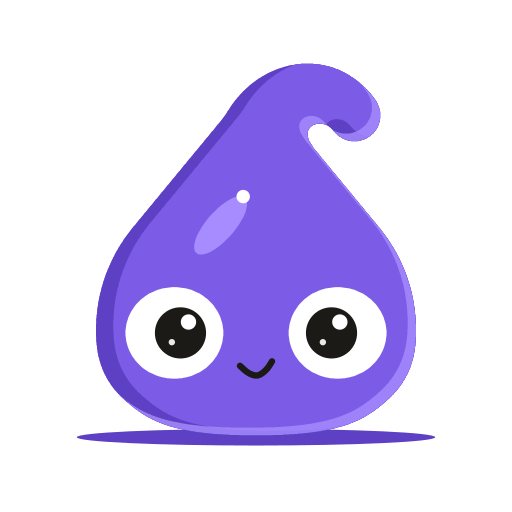
</p>

<h1 align="center">Lexicommons</h1>

<p align="center">
  Learn a language for free: short lessons with pictures, real books with English when you need it,<br>
  and everything you know where you can see it.
</p>

<p align="center">
  <a href="https://lexicommons.com"></a>
  <a href="https://lexicommons.com/try/"></a>
  <a href="LICENSE"></a>
  <a href="CONTENT-LICENSE.md"></a>
</p>

<p align="center">
  <picture>
    <source media="(prefers-color-scheme: dark)" srcset="docs/readme/hero-dark.webp">
    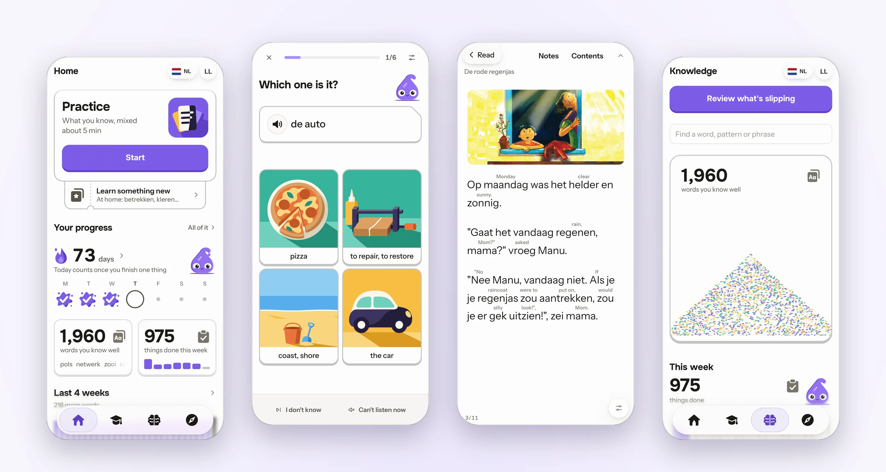
  </picture>
</p>

Pick a language and Lexicommons gives you one simple thing to do each day: short lessons that teach a few words at a time, then bring them back as you start to forget them. Over 700 Claude-drawn SVGs teach the words, and about 170 of them move when you're right and when you're wrong. Around that there are picture books to read, a translator, and packs to add to what you study.

Eight languages have a full course of 200 lessons each: Dutch, Spanish, French, German, Portuguese, Italian, Russian and Japanese. 67 more have a starter pack: 75 languages in all.

It's made for your phone, works on a computer too, and installs like an app. It's free, with no ads, and the code and the lessons are open. **The app:** https://lexicommons.com. **Two lessons first, with no account:** https://lexicommons.com/try/

## What's in it

<table>
  <tr>
    <td align="center" valign="top" width="33%">
      <picture>
        <source media="(prefers-color-scheme: dark)" srcset="docs/readme/games-dark.webp">
        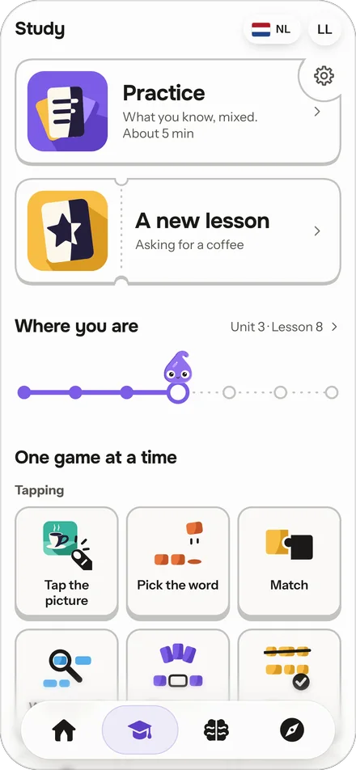
      </picture>
      <br><b>Study</b>
      <br>Practice mixes what you know. Or play one game at a time, tapping, typing or speaking.
    </td>
    <td align="center" valign="top" width="33%">
      <picture>
        <source media="(prefers-color-scheme: dark)" srcset="docs/readme/review-dark.webp">
        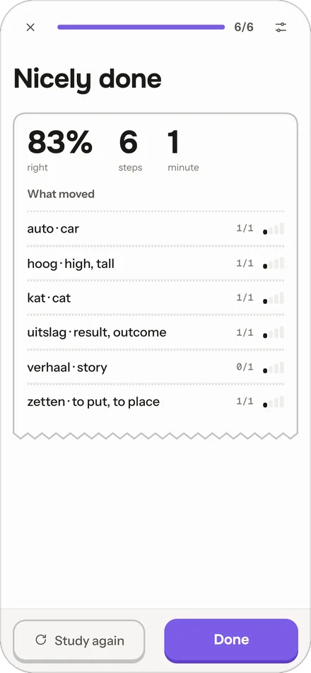
      </picture>
      <br><b>What you miss comes back</b>
      <br>Everything you learn comes back just before you'd forget it. What you miss comes back sooner, until it sticks.
    </td>
    <td align="center" valign="top" width="33%">
      <picture>
        <source media="(prefers-color-scheme: dark)" srcset="docs/readme/path-dark.webp">
        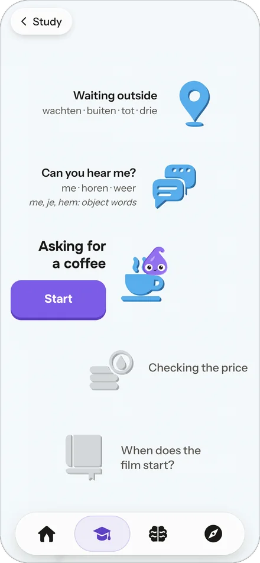
      </picture>
      <br><b>The path</b>
      <br>A full course is 200 short lessons in units. A topic pack you add comes in after the unit you're in.
    </td>
  </tr>
  <tr>
    <td align="center" valign="top" width="33%">
      <picture>
        <source media="(prefers-color-scheme: dark)" srcset="docs/readme/woven-dark.webp">
        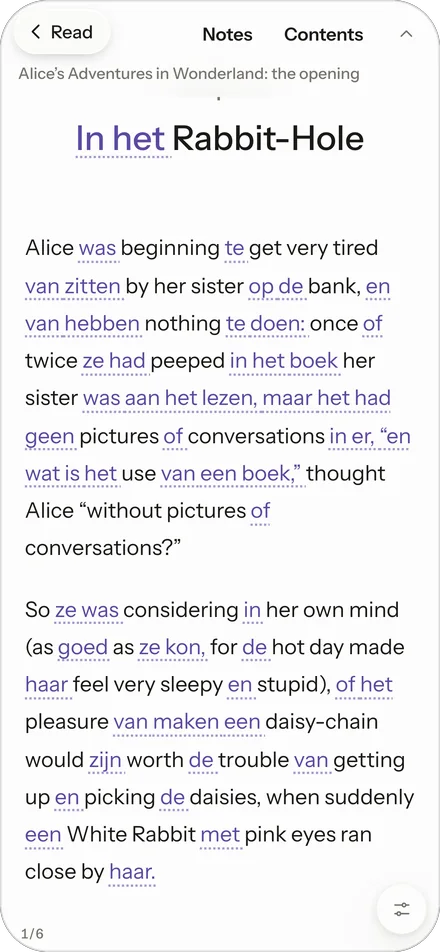
      </picture>
      <br><b>Read it woven</b>
      <br>The words you know appear in the language you're learning, each in its place. Your own AI weaves a text you choose; the opening of <i>Alice</i> shows how.
    </td>
    <td align="center" valign="top" width="33%">
      <picture>
        <source media="(prefers-color-scheme: dark)" srcset="docs/readme/translate-dark.webp">
        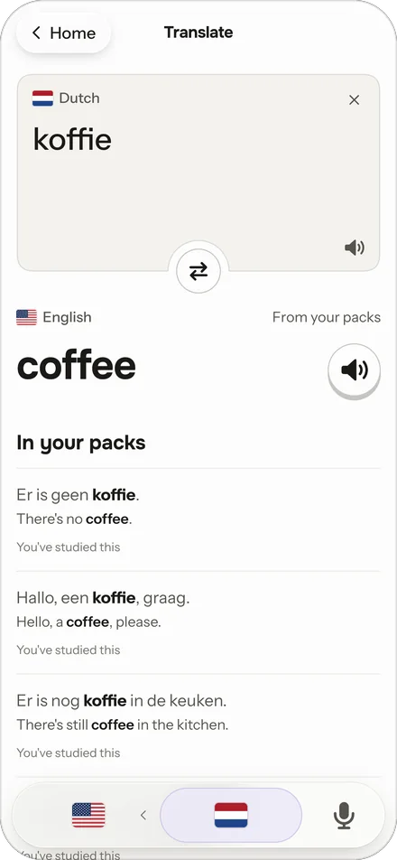
      </picture>
      <br><b>Translate</b>
      <br>Look up a word or a sentence and see it in real sentences, the ones from your packs first.
    </td>
    <td align="center" valign="top" width="33%">
      <picture>
        <source media="(prefers-color-scheme: dark)" srcset="docs/readme/explore-dark.webp">
        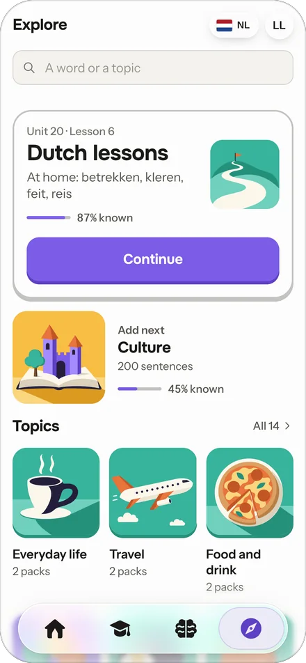
      </picture>
      <br><b>Explore</b>
      <br>Topic packs to add to what you study. Make your own by hand, from an Anki deck, or with your AI.
    </td>
  </tr>
  <tr>
    <td align="center" valign="top" width="33%">
      <picture>
        <source media="(prefers-color-scheme: dark)" srcset="docs/readme/ai-dark.webp">
        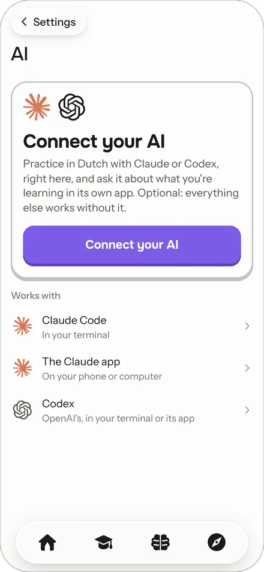
      </picture>
      <br><b>Your own AI, if you want one</b>
      <br>Connect Claude, Codex or any app that speaks MCP. Everything else works without it.
    </td>
    <td align="center" valign="top" width="33%">
      <picture>
        <source media="(prefers-color-scheme: dark)" srcset="docs/readme/themes-dark.webp">
        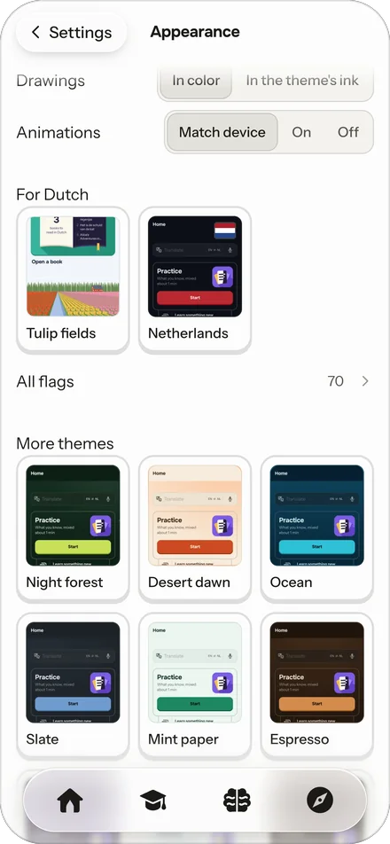
      </picture>
      <br><b>Make it yours</b>
      <br>Ready-made themes, flags and pictures for many languages, or one your AI makes for you.
    </td>
    <td align="center" valign="top" width="33%">
      <picture>
        <source media="(prefers-color-scheme: dark)" srcset="docs/readme/try-dark.webp">
        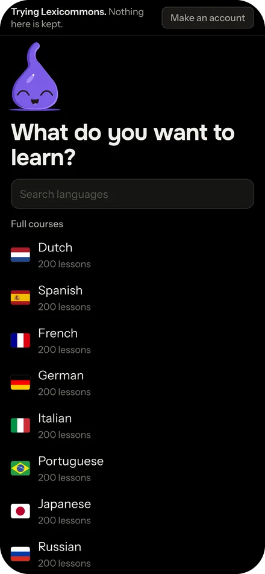
      </picture>
      <br><b>Try it first</b>
      <br>Two lessons with no account, and nothing kept. <a href="https://lexicommons.com/try/">lexicommons.com/try</a>
    </td>
  </tr>
</table>

### On a computer too

<picture>
  <source media="(prefers-color-scheme: dark)" srcset="docs/readme/desktop-knowledge-dark.webp">
  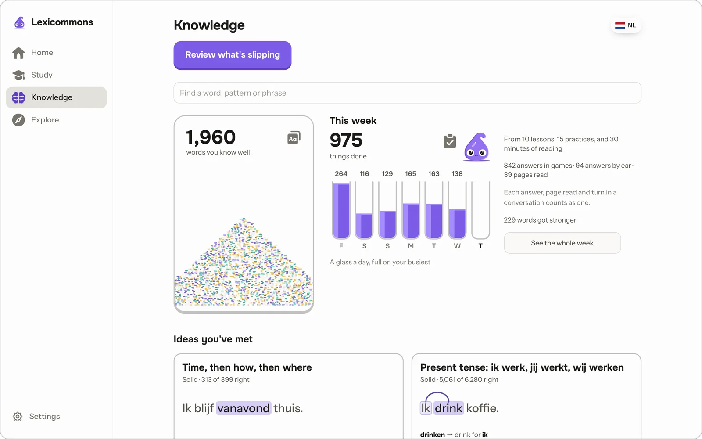
</picture>

Knowledge shows every word you know and how well, what you did this week, and the ideas you've met. A day counts once you finish one thing, and rest days and pauses are part of your streak.

## Reading

The picture books, in 33 languages, each have English beside the text or a tap away on each word. The library can't carry the books most people want to read, because they're under copyright: that's what weaving your own is for. Ask your own AI to weave a text into the language you're learning (48 languages so far) and read it here: the words you know show in that language in the English sentence, and a sentence you know most of turns into it whole. The opening of *Alice's Adventures in Wonderland* is woven into 11 of them as an example.

## Your data stays yours

No ads and no tracking. Your progress and your packs are kept with your account, so they're there on any device you sign in on. You can also keep them in step between your devices through your own cloud storage, with your packs' recordings too. The books and texts you add stay on your device. Settings → Your data downloads everything we hold, or deletes your account.

## Your own AI, if you want one

Nothing in Lexicommons needs an AI. If you use one already (Claude, Codex, or any app that speaks [MCP](https://modelcontextprotocol.io)), you can connect it to your account at `https://lexicommons.com/mcp`. The AI section's Connection page shows how for Claude and Codex, and what any other app needs. Then it can:

- coach you from your own mistakes, reading what you've studied, and practice with you;
- make packs for what you want to learn, which come onto your path after the unit you're in;
- add texts to your reading library, and weave them;
- restyle the app.

For each, the tools hand your AI a guide first (`get_coaching_guide`, `get_practice_guide`, `get_pack_guide`, `get_text_guide`, `get_weave_guide`, `get_theming_guide`): the format, worked examples, and every check what it sends goes through. It works through your own AI app and your own account with it: Lexicommons runs no AI of its own and sees no conversation you don't send it.

## Run your own copy

You can run all of it on your own computer, so nothing goes through anyone else. From a clone, with Node 24:

```sh
npm run local
```

[docs/self-host.md](docs/self-host.md) covers updating, removing, and what's different on a copy. You can also host it yourself, though we don't support or test that.

## Working on it

It's a Cloudflare Worker with D1, KV and R2, serving a web app with no build step. `AGENTS.md` has the commands, the checks and the rules. [CONTRIBUTING.md](CONTRIBUTING.md) says how changes come in, and [SECURITY.md](SECURITY.md) how to report a security problem.

Some comments and docs point at files in `../`, such as `../brief.md` or `../docs/…`. Those are the project's planning notes, which are kept outside this repo and aren't published.

## Ideas and bugs

In the app, **Settings → Report a bug** sends a bug with the screen you were on and your device's details, and shows you all of it first. On GitHub, [open an issue](https://github.com/Imaginative-Prompting/lexicommons/issues/new/choose): there's a form for a bug and one for an idea. A security problem goes to [SECURITY.md](SECURITY.md) instead.

## License

Lexicommons is free software under the GNU Affero General Public License, version 3 ([LICENSE](LICENSE)). If you run a changed copy for other people to use, the AGPL asks you to offer them its source.

- **The content** (language packs, lessons, word packs, grammar, pack notes and the word pictures) is under Creative Commons Attribution-ShareAlike 4.0 ([CONTENT-LICENSE.md](CONTENT-LICENSE.md)). When learners can share packs in Explore, what they share is CC BY-SA 4.0 too, and the app says so before anything is shared.
- Third-party parts keep their own licenses, in files beside them: the fonts (SIL OFL 1.1, `public/fonts/`), the flags (MIT, `public/flags/LICENSE`), the sound effects (`public/audio/fx/LICENSES.md`) and the libraries in `public/vendor/`.
- The Google and GitHub marks on the sign-in buttons belong to those companies, and this license doesn't cover them.

## Credits for the open content

<details>
<summary>Word frequencies, word forms, the books, the recordings, the translator and speech on your device</summary>

- **How common each word is:** [FrequencyWords](https://github.com/hermitdave/FrequencyWords) by Hermit Dave (CC BY-SA 4.0), counted from the subtitles of [OpenSubtitles](http://www.opensubtitles.org/), through OPUS's OpenSubtitles2018 (P. Lison and J. Tiedemann, 2016, "OpenSubtitles2016: Extracting Large Parallel Corpora from Movie and TV Subtitles", LREC 2016). The Knowledge page credits it where its numbers appear.
- **Word forms and lemmas:** [Wiktionary](https://en.wiktionary.org/) contributors (CC BY-SA 4.0), through kaikki.org's Wiktextract (Tatu Ylonen, 2022). Which lemma a form that can be two is: [UD Dutch Alpino 2.18](https://universaldependencies.org/) by Gosse Bouma, Gertjan van Noord and the Universal Dependencies contributors (CC BY-SA 4.0).
- **Books in the open library:** open books from [StoryWeaver](https://storyweaver.org.in/) (Pratham Books), [Global Storybooks](https://globalstorybooks.net/) and [African Storybook](https://www.africanstorybook.org/), [Bloom Library](https://bloomlibrary.org/), [Dutch Wikibooks](https://nl.wikibooks.org/)' Wikijunior and [Standard Ebooks](https://standardebooks.org/), each under its own license: CC BY 4.0, CC BY 3.0, CC BY-SA 4.0, CC0 or the public domain. The shelf keeps growing. Each book's full credit (author, illustrator, translator, license, source and any corrections) is in the library's catalog, and on the book's page in the app; the books a copy of this repo starts with are in `library/catalogue-seed.json`. For example, *Alice's Adventures in Wonderland* (the opening), by Lewis Carroll, is public domain, and its text is [Standard Ebooks](https://standardebooks.org/)' production, dedicated to the public domain (CC0 1.0); *The Tale of Peter Rabbit*, by Beatrix Potter, text and pictures, is public domain, from Frederick Warne & Co.'s first edition. A book's pictures are its illustrators', under the book's license. The help in English and the woven layers the library adds to its books are made for Lexicommons with an AI model and checked sentence by sentence, under CC BY-SA 4.0; each one's entry in the catalog names the model.
- **Recordings** of the Dutch starter (`public/audio/starter-word-order/`) and of Dutch's lessons (in the library): Emma and Ido, synthetic voices made with ElevenLabs for Lexicommons, CC BY 4.0.
- **The full translator:** Mozilla's translation models, the ones Firefox Translations uses, and bergamot, the runtime that runs them (`public/vendor/bergamot/`), under the Mozilla Public License 2.0. The models are in the library; Translate offers them as a download.
- **Speech on your device:** OpenAI's Whisper models (MIT), as Hugging Face's onnx-community converted them, run by transformers.js and ONNX Runtime Web (`public/vendor/`). They aren't in this repo: `npm run local -- speech` fetches them.

</details>

The screenshots are of a local copy of the app (`npm run local`), with a made-up learner's progress.
