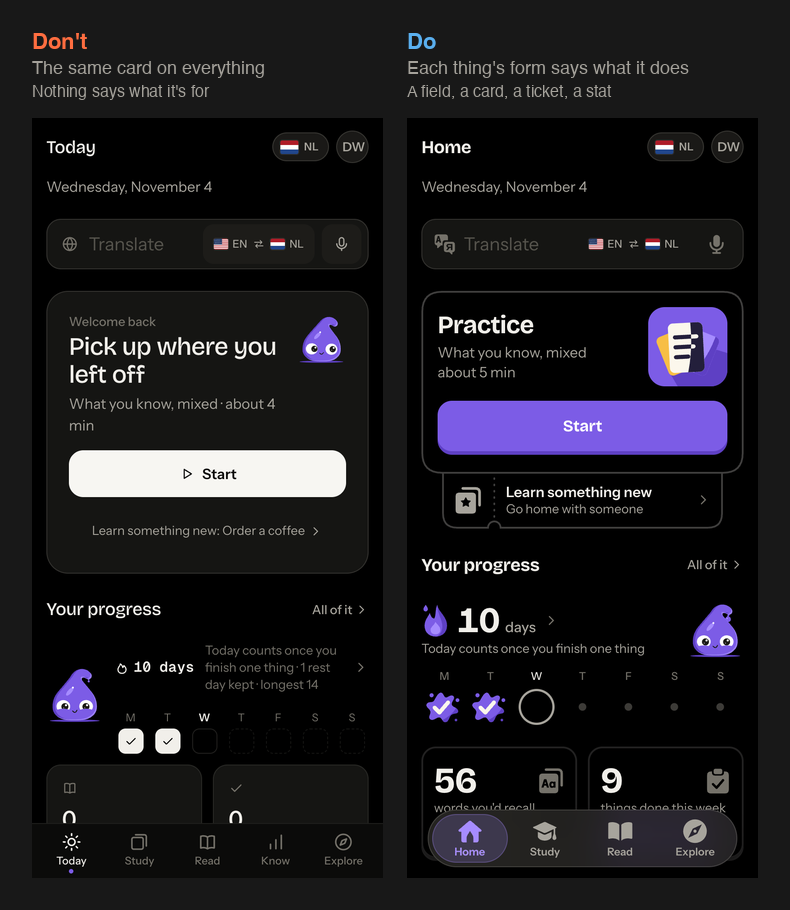
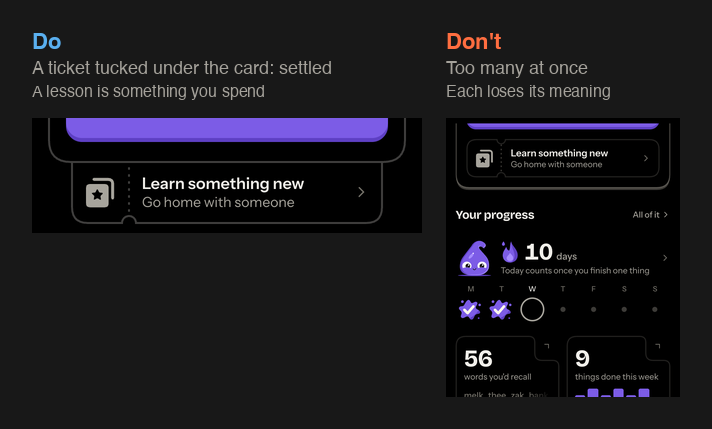
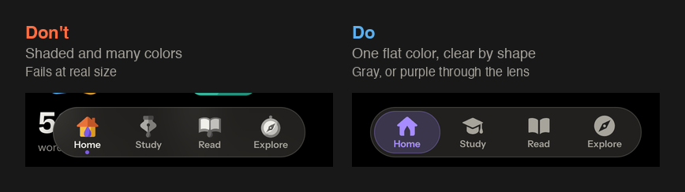
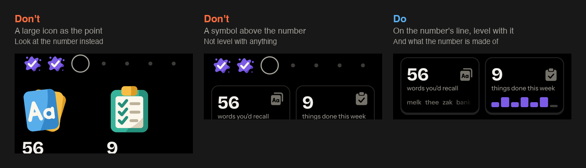
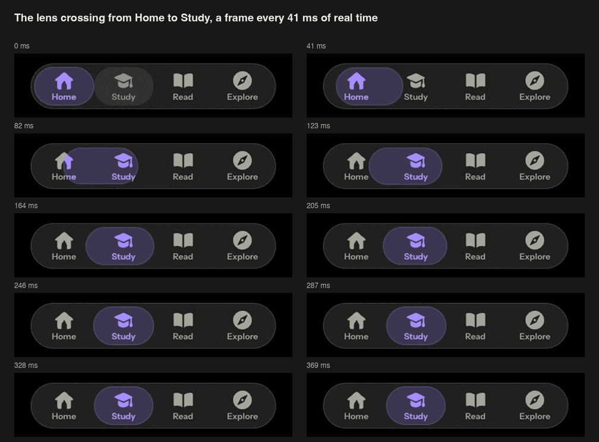

# The Lexicommons design bible

How every screen in the app looks and why. Design any screen from this; the games have their own, [games-bible.md](games-bible.md). Component details and the theming surface are in `docs/design-system.md`.

**Status words:** *settled* was chosen on the real screen. *Being chosen* has options out, so don't build on one option. Home and the floating bar are built this way; other screens keep their content under the new bar until theirs are chosen.

## The idea

- **The page is quiet, and each thing's form says what it does.** Sameness made the old app look clean and mean nothing: every block was the same card.
- **Color lives in the art and the way forward,** so where it appears it means something.
- **Before adding a box, a color or a word, ask what job it does.** If it has none, it goes.

## Surfaces

Choose by what the thing does. Most things need none.

| It's something you… | Surface | Examples | Why |
|---|---|---|---|
| read | **Neither** | The streak, the week, a chart, headings, list rows | Nothing happens inside it, so a box only adds noise |
| are being asked about | **A flash card:** a clipped corner, nothing behind it | The sentence in a question | Even with no voice, it has to read as the thing in question |
| can press, among other things | **Border, no background,** with a hard edge under it | The main card, stat tiles, answer options, Learn something new | The edge says "this does something" with no weight |
| type in, or are inside | **Background and border** | Translate's field, a sheet | It's a place, so it looks like one |
| press to move forward | **Solid, with a hard edge** | Start, Continue | It's a control, not a card. One per view |

- **Art as the card:** where most of a card you press is its colored art tile, the tile is the card, with no border and a hard edge in its own deep tone (Home's cards).
- **Nothing boxed inside a box** unless the inner thing is itself a control. Translate's direction and mic have no fills.
- **The hard edge is a line of `--line` or `--line-strong`,** never a soft shadow. Nothing behind a card is painted, so a theme's background still shows.
- **Do:** Home's main card. **Don't:** a filled box around text you only read, such as a sentence in a gray pill.

## The way forward

`--go`, `--go-deep`, `--on-go`: Tinta's violet in color, the theme's `--solid` in a theme's ink.

- Solid, full width, 56 px, heading font 700, a 4 px edge in `--go-deep`, and no icon: its words say it.
- Pressing pushes it down onto its edge.
- **One per view.** When nothing should push, as after you've practiced today, the same action becomes a border with no fill.

## Off shapes

A card can have an off shape only if the shape says something true about that thing. No reason, no shape.

**How many:** one or two on a screen, and a shape means one thing everywhere.

| Shape | Means | Where | State |
|---|---|---|---|
| **Hinge:** a round bite out of the foot of Translate's box, holding the swap | What you typed is above, the answer below, and this is the way between them | Translate's page | First mockup, not chosen yet |
| **Ticket tucked under the card:** a stub coming out from under the foot, with a tear line and a bite | The next lesson is something you spend, and it's the other way forward | Learn something new, under Home's main card and any next lesson | Settled |
| **Ticket with a bite top and bottom** | The same: a lesson is something you spend | The new lesson's door on Study | Settled |
| **Clipped corner** | A flash card: this is the thing being asked about | The sentence or word in a question | Settled |
| **Receipt, a torn zigzag foot** | A tally of what you did | A session's end | Settled |
| **Notch:** the card's top corner bitten by a circle, a small control in the bite | The control is the card's own (its settings), not a loose mark on it | The Practice card on Study, holding Study's settings | First take |

A stub with nothing to tear off ("Or practice", "Find more in Explore") has the same place and no tear or bite.

Tried on Home and left out: a clipped corner on the main card, an index tab, a bite with the art in it, a speech tail on Translate, a dog-ear and a receipt foot on the tiles, a deck of cards under the main card, swiping through cards. Any of them can come back with its reason, somewhere it says something true.

- **How:** `lx/edge.js` draws the outline as a line that fits the card and measures what's in it, and paints nothing behind it. Add a shape there, and to this table, with its reason.
- **Keep the press area square.** A shape changes the drawing, not where a press lands.
- **Something underneath has a use.** A shape that looks like it does something and doesn't feels wrong.
- **Lines that meet are one path in a solid color** (`--line`, `--line-strong`). Translucent strokes that overlap double up where they cross, and separate shapes poke past each other. Each line ends on the line above it.
- **Don't:** several shapes at once, or a shape that collides with a symbol. A bite in a tile's corner was dropped because it fought the symbol on the number's line.

## Symbols and pictures

Everything is drawn for this app. There are four kinds, and quiet is the default for anything small or repeated.

| Kind | How it's drawn | Size | Where |
|---|---|---|---|
| **Tabs** | One flat color (`currentColor`), clear from the shape alone, no shading | 28 | The bar |
| **Quiet** | One flat color, still custom, in `--ink-3` or `--ink-2` | 22–32 | Translate, the mic, row symbols, a stat's symbol |
| **In color, small** | Flat, two or three paints, no outline | 40–44 | The streak's flame, the week's splat |
| **Hard light** | A split object on its own rounded tile | 64–150 | The main card's art, word pictures |

- **Judge every symbol by its shape at real size.** Ask what it is with no label, at 1× on the phone. Detail is negative space, if any.
- **Hard light:** a hard split down the object, cream against `--art-ink`, a long hard shadow in the tile's deep tone. Its art carries its own rounded tile, because half the object would vanish on a bare page.
- **Tiles use only sun, teal and violet.** `--art-sky` is nearly the right color and `--art-clay` nearly the wrong color, so a blue tile reads as already right and an orange one as already wrong. Neither ever stands for a state.
- **Small working marks** (chevron, close, plus, more) stay simple. Drawing them adds noise.
- **Real logos and flags** stay as they are.
- **A book is drawn one way everywhere:**
  - With no picture of its own, it's the book in hard light: one of the art's paints for objects (violet, clay or sun, `ui.coverPaint` from its id, the same on Home's card, Read's shelves and Find a book), split lit and deep, its title in the app's face.
  - Its words cross the split, so they read at 4.5:1 on both tones, in color and in the theme's ink. For that, violet is a touch deeper than the art's violet and clay's deep is a softer step. In the theme's ink a clay book is the darkest step, with paper words, and sun's deep is a lighter step (`components.css` and `know.css` hold the inks; read-scale-check measures both tones).
  - The book you're reading is Home's card's drawing, on Home and at the top of Read.
  - A book whose cover is its own drawing (Alice's pocket watch) shows the drawing whole, with no split, and its title under it as a picture book's is (shelf.js `asDrawn`).
  - A title cover carries its title, so the title isn't said again under it.
  - A book's own picture stays as it is.
- **Inline SVG from `lx/symbols.js`,** colors from `--art-*` tokens or `currentColor`, so monochrome and custom themes work. Rules: `lx/art-rules.js`.

**Don't:** many colors in a small symbol. The first Translate symbol was too busy in color, then too busy with its gap cutting a letter. Quiet and clean won.

## Color

Designed in color first, with tokens in `css/lx/art.css`.

- **Paints:** violet (Tinta, the way forward, the streak, the week, the chart), sun, teal, and sky and clay on objects only. Paper and `--art-ink` for cream and dark.
- **Meaning colors** stay as they are, and never alone: right and wrong always have a mark, a word or a shape too.
- **Colorblind-safe by default.** Check every new pairing in a simulation.
- **Monochrome and custom themes:** `data-art="theme"` draws everything in the theme's own ink. A theme can also set `--art-*` itself. Tinta stays violet, the one splash of color (being chosen).
- **The site and the app:** the site's pages (the public page, signing in, creating an account) follow the phone's light or dark, never a
  look saved on the device (`src/pages.ts` lxLayout, `data-site-look`). The app keeps its own look, Graphite with nothing saved, the look
  the launch video shows. So the one change of colors is the step from signing in into `/app/`, a whole new screen: the app's first paint
  is already Graphite, the splash's first frame (Tinta, as the installed app's launch image) while a newcomer's start holds, and the first run
  fades in whole over it (`scripts/signin-check.mjs` holds both). A decision of 7 Nov 2026 (rather
  than Match device as the app's default, or a dark public page), open to revisit.

## Type and space

- **Numbers:** heading font, 700, 40 px. No monospace for counts.
- **Titles:** heading font, 700, 28–34 px on the main thing.
- **Labels:** 14 px in `--ink-2`.
- **One line per idea.** The detail goes on the page it opens. Don't say the same word three times on a screen.
- **Sentence case** everywhere. Numbers and words in American spelling.
- **Space:** 16 px gutter, 24 px between blocks, and room under the last thing to scroll clear of the bar.

## A stat

The number leads, in an outline because it opens something. Then:

1. A **quiet symbol on the number's own line, at the far end,** its ink exactly as tall as the digits, top and bottom level. Measure it; don't judge by the box.
2. A **short label** under the number.
3. **What the number is made of:** the real words, or a bar per day that adds up to the count.

**Don't:** a large icon as the point of the tile, a symbol sitting above the number, or a picture of a number that doesn't match it.

## The bar

A floating pill over the content, which runs under it to the foot of the screen. Settled.

- **Tabs:** Home, Study, Knowledge (a brain: What you know, until its own page comes), Explore, and AI before Explore when the setting puts it there. Symbols only, no names under them; each name stays its tab's accessible name, and the sidebar shows them. Read is Home's book card, and Settings is behind your initials.
- **Size:** 64 px tall, 84 px a tab, the screen less 12 px a side. 12 px off the foot, or 22 px in an installed iPhone.
- **Surface: liquid glass,** first take. Thin, what's under it blurred and dimmed, a light edge and a highlight along its top, no refraction. Its words are in the theme's strongest ink and the tab you're on sits on a lens with body, so every label keeps 4.5:1 over anything, even a white page. Solid with Reduce Transparency, in High contrast, and where a browser can't blur.
- **The tab you're on is a lens:** a gray row of links, with a purple copy over it clipped to a moving bubble. Half covered, an icon is half purple.
- **The bubble:** two springs, one per edge, the leading one quicker. It stretches, travels, and settles with a few pixels of overshoot, in about a third of a second.
- **Never blocks:** links never move and it takes no presses, so a second tap turns it from wherever it is. With Animations Off, it's just there.
- It stays put while scrolling, steps aside for the keyboard, and becomes the sidebar from 1024 px.
- **A page runs to the foot of the screen, under the bar,** fading out under it. A page's pinned action stops above the bar, with the page's color behind it down to the foot; a sheet lies over the bar; a session covers it.

## The top and the way back

- **No bar at the top.** The page, its color and pictures, runs to the top of the screen; what scrolls up fades away under the header. First take.
- **One title form.** A tab's own page names itself in the header, at the left (Home, Study, Knowledge, Explore, AI): it never scrolls away. Any page you went into has the floating back pill in the header and its title large at the top of the page (`ui.pageTitle`), with its line under it. As that title scrolls under the header, the same words come in centered in the header (`bar-title`), their opacity following the scroll both ways (0 to 1 over the last 24 px), so the page's name never scrolls away (7 Nov). A page put back where it was scrolled shows it in place from its first frame. Never a title beside the pill, at the header's end or in gray.
- **Where the centered title would meet the pill** (a narrow phone, a long back label): the title stays centered and never covers the pill; the pill gives way to its chevron alone (still 44 px, "Back to …" for a screen reader), and a title still too long ends in "…". Decided as the page arrives, never as it scrolls.
- **The way back is one button everywhere:** a floating pill of the bar's glass, a chevron and where it goes back to. The header's, a sheet's, the reader's, a picker's. `ui.backButton`; `scripts/test-back-buttons.mjs` fails on any other.
- **The language and your initials** are the same glass.

## Rows

A row's end says what a press does, so nobody has to press to find out.

| It… | Its end | How |
|---|---|---|
| goes to another page | The chevron | `ui.listRow({ href })` |
| opens a sheet over this page | No end: the row is a button, a border with a hard edge under it | `ui.listRow({ onclick, opens: "sheet" })`, which also tells a screen reader a dialog comes (`aria-haspopup`) |
| acts here (turns something on, starts something) | Nothing, or its value | `ui.listRow({ onclick, trailing: … })` |

- **The chevron means a page and nothing else.** A drawer with a page's arrow promises somewhere it doesn't go.
- **A sheet's row as a button is a first take, not chosen yet.** The options beside it: a mark drawn as a sheet with its handle (too small to read at a row's size), and a chevron pointing up.
  Two exceptions so far, each plain with no box and still no chevron:
  - Settings → Admin draws its sample learner's row beside three plain rows, so the four read as one list.
  - Read's Add a book or text sits at the page's foot under a hairline (read.css `.lx-library-add`). Adding your own is the quiet way in; finding a book is Read's face. The page runs: the book you're in (or a good first book), Find a book (the search, the lead shelf's covers in a grid, two picture books across and six shown, then every other shelf's covers in a row, each with its All when it holds more), Your library once it holds something, then Add.
- `scripts/sheet-row-check.mjs` presses every row on every page and holds each to its end.

## Home's cards

Under Your progress, Home's cards (`know/home-cards.js`, the part `home-card`): each one idea with one hero, its live data in it, and the app's own art. Settled.

- **Where most of a card is its colored art tile, the tile is the card:** no border. It has a 4 px hard edge in its own deep tone, and a press pushes it down onto that edge. Its title and one line sit under it.
- **The book:**
  - Read's own symbol drawn big. A hard-light book on Read's teal tile: its cover split lit and deep, a long hard shadow in teal-deep, and a ribbon under its foot.
  - Its cover takes violet, clay or sun by the book's id, never the cover's own colors, and carries the book's own name.
  - It opens as you scroll to it, onto where you are. The lit page has the chapter (or page) number in Home's number face with its title. The page in shadow has the sentence you're at: a woven book's as the reader weaves it, a picture book's beside its page's picture.
  - Its angle is a pure function of where the book is on the screen: shut until it's all in view, open once its top is a quarter of the way down, closing as you scroll back. With animations off, it's open.
  - Under it are the title and where you are. The way to every book is the end of its **Reading** heading (All books), as All of it is on Your progress, never a row inside the card.
  - With no book, it's Read's own book, opening onto how many books the shelf has for your language and its first ones.
- **Your AI:**
  - Only with one connected, and only while it has no tab, under its own **Your AI** heading, so it never reads as part of Reading.
  - The exchange is the art, drawn in hard light on a sun tile. Its line in the language sits in a paper bubble with its meaning, and your answer in an ink bubble, each with a long shadow in sun-deep.
  - Tinta stands on the tile's floor beside your answer, clear of both, and reads the line once it's seen.
  - When your AI is waiting on you, your bubble is an empty dashed one: "Your turn".
- **Notices** (reminders paused, adding the app to the Home Screen) are doors, as Study's: a border, nothing behind it, a hard edge, with the title and one line (adding the app has its drawing; reminders paused has none).
  - Not now is the cross in the card's corner.
  - A notice says only what's true now and the way back, never what went unanswered.
  - On a small phone its title runs whole, never cut.
- **Last 4 weeks** shows once all four weeks have words. Before that it would be a few bars at the end of an empty month, and the two tiles above it say it.
- No glow, no stock icons. A card is one press. A card with a second way (the install card's cross) presses by its parts, never as a whole.

## Settings

A short list, grouped by what a person came to do, by space and no headings. First take, not chosen yet.

- **The root:** a quiet symbol with no tile, a word, and at most a value. No subtitles.
- **Deeper pages:** words only. No symbols and no tiles. A choice that is a look (Appearance's themes) shows its picture: there the picture is the choice, not a tile behind a word.
- **Explanations** go in a sheet behind a row (`wordsRow`, in `shell/settings.js`). A note under a group is only for what would otherwise surprise someone, such as this being your only way to sign in.
- **A choice between short options** sits on its row. Long ones are a plain list, the chosen one bold with a check.
- **Something that clears or deletes** is a plain row until it's pressed, then red and asking. Only deleting your account or a pack is red from the start.
- **A page's one forward action** is the solid one, as anywhere else: Turn on reminders, Choose a file.

## When something fails

- **Never a blank and never a code.** What didn't go is said in plain words; `server_error` or "Failed to fetch" never reaches a screen (`shell/api.js` words every failure).
- **Offline, a page shows what this device has.** What only the server has says it needs a connection, with Tinta dozing, and comes back by itself once you're online.
- **Online, a failure says what went wrong, with Retry,** and Tinta slumps beside the words, then peeks at Retry. A press works the whole time. `ui.loadFailed` does both for a page or a part of one.
- **A failure on a button stays by the button** (a line under it, the button still there); the page doesn't change under you.

## A rule's picture

A concept's sheet (`study/after-answer.js`) teaches with your own sentence, drawn (`study/concept-picture.js`).

- **The rule's words are lit, and its shape is drawn on them,** from the concept's `picture` in the grammar's longer file:
  - **order:** a bracket under the two parts that close around the middle (heb … gedronken, dat … kunnen eten). Or, for a rule about one word's place, the parts of its own clause numbered and that word's number ringed, counted the Dutch way (everything before the verb is one part). The numbers only show when the word is first, second or last. A concept can say `frame` (never counted) or `place` (never bracketed); `order` is worked out from the roles.
  - **ending:** the ending set apart in violet, by the word's own spelling (verhalen: the *en*, never a made-up stem), and a verb's ending gets an arc to who it's for: "drinken → drinkt for mijn moeder".
  - **agreement:** an arc over the words that go together.
  - **article:** a box around de or het and its noun.
- **A line under it says the shape in words** ("drinken → drinkt for mijn moeder", "bent goes with je", "ligt (the verb) comes second"). Word for word in English sits beside it when the words line up one for one.
- **The marks come from the notes;** what goes with a marked word comes from each word's role (`study/concept-shape.js`, tested on real sentences by `scripts/test-concept-shape.mjs`). Where the roles don't say enough, nothing is guessed: the sentence is simply lit. Punctuation stays outside the light.
- **Why, then more of your own sentences** you've played (the grammar's examples when you have none), then how you're doing. In the why, the language's words are set in violet, not lit, so the picture stays the one thing lit.
- **It draws in once as the sheet comes up,** words first, then the shape, starting from blank. It never moves after that, and with animations off it's simply there.

## Tinta

The app's character, in violet. It's decoration: nothing waits for it, and it takes no presses, except where it stands on a tab: there a tap
pokes it (it splats, giggles, slides off and back, and every fifth time squirts, grumpy), and opens nothing under it.

- **Don't put it beside another drop shape.** Two purple drops side by side read alike. At the streak it sits at the far end of the row, away from the flame. To change that, see `css/lx/redesign.css`; the same flame in yellow is the other way to keep them apart.
- **It's a character, not an icon.** It reacts, waits and throws; a symbol doesn't.
- **Never in the reader.** Every empty state has it, in a pose for its words.

## Motion

- **Nothing ever blocks a press.** State changes first; a press finishes or redirects what's moving. `lx/motion.js` enforces this.
- **Once, as a page arrives, and only where it earns it,** on a part inside a control, never moving what you press.
- **Animations Off and reduced motion mean none.** Test both.
- **Every animation ends.** No looping CSS.

## What arrives late

Nothing just flashes onto the screen. A page comes in whole, or what it waits for comes into the place held for it.

- **What the device has is in the page's first frame:** a row's value ("Off", "Graphite", "13 on"), counts, the person's own data, Tinta's place. A page that draws it a moment later gives the router `view.ready` once it's drawn. The router holds the page unseen until then, 400 ms at most, and brings it in whole.
- **What waits on the network or a slow store holds its exact place:** `ui.held(shape, holds)`, the same size, corners and position as what comes, in the quiet fill with a slow pulse. It's never empty space that something pops into, and never a guess at the content.
- **It arrives into that place:** `ui.arrive(holder, node)` swaps the held place for what came, fading it in (opacity only, nothing moves; at once with animations off). `ui.arriveIn(place, …nodes)` does the same for a place that already has its size (a picture's square, a cover). A height that doesn't match is marked `data-holds-mismatch` and fails the frame-watch gate.
- **Pictures fade into their place.** A drawing loads after the page, so it comes in through `ui.arriveIn`, never by a bare `replaceChildren`.
- **A skeleton is never shown for what the device already had.** The gate runs again with the server cut off to tell the two apart.

## Always

- **No AI outside the AI section.** No prompt, button or empty state pointing to one. The one exception is Add your own pack's "Make one with your AI" (Explore, `explore/own.js`), drawn only while an AI is connected; with none, nothing there names one.
- **No pressure:** no warnings, countdowns, loss counts, sad characters or "missed" marks. A day you didn't study is a plain dot.
- **What you see is what's true.** Don't promise, invent or round up numbers.
- **Every control:** 44 × 44 px reach, a pressed state, 8 px apart, no text under 12 px, quiet by its ink rather than by opacity.

## Before you show anything

1. Each symbol alone and large (480 px), then at real size. Crop anywhere lines meet at 3x and look at it alone: a whole-screen sheet hides those flaws.
2. The screen in its real states: brand new, just after a first use, a few weeks in.
3. Dark, light, monochrome, a custom theme, a colorblind simulation.
4. 390 and 320 wide, and the installed iPhone. The last thing clears the bar.
5. Animations Off, reduced motion, a press mid-move.
6. A real walk in a real session, on real data. A check passing says nothing about whether it's good to use.
7. Options side by side with the bare version, each with its reason and your pick. No dates or estimates.
8. A flaw you can see goes back. It doesn't go to the owner.

## Still being chosen

- The flame and Tinta at the streak, if they still read alike on the live screen.
- The way in after a question hanging off the words, and its sheet being plain: in as picks, not yet answered.
- The path and its units on Study.
- Where you are: every lesson a large solid icon of its theme that is itself the button (`lx/stop-art.js`), wandering slowly from side to side as the drafts did, with no line and no glow; its title on the side with room, its words and its idea in italics under it; done in its unit's color, ahead gray, lighting up as they come into view; your place bobbing with Tinta standing on it; a tap opens a bubble right there; each unit ends in its gold medal.
- First mockups, not yet answered: More ways as plain rows with packs last, What you know with its number alone first and a row for everything else, Streak with pausing and how it counts as sheets.
- Tinta's color in monochrome.
