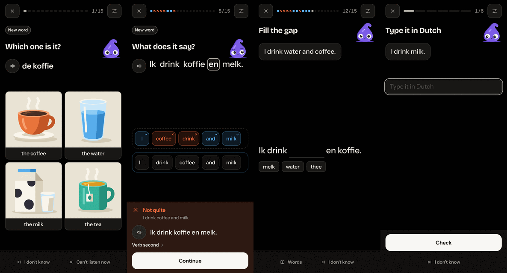

# The Lexicommons games bible

How a question looks and behaves. It's a different kind of screen from the rest of the app: one thing at a time, nothing to scroll, your thumb near the bottom. Everything else follows the [design bible](design-bible.md).

**State of each part:** **Settled** was chosen. **Built** works and is live or landing, but its look hasn't been chosen. **Open** has options to come.

## A question, top to bottom

| Part | What it is | State |
|---|---|---|
| Session bar | End, one line of ink for how far you've come, the count, and the games sheet | Settled |
| Tag | "New word" or "Once more", only when true | Built |
| Instruction | What to do, heading font, bold, one line where it can | Built |
| Tinta | Beside the instruction, 64 px, 44 on short screens | Settled |
| What it's about | The word or sentence on a flash card with a clipped corner, with its speak button | Settled |
| The game | Tiles, options or pictures, each with an outline and a hard edge | Settled |
| Quiet actions or Check | I don't know, Can't listen now, Can't speak now, Words, Hint | Built |
| Answer panel | The result, in the result's color, sliding up over all of this | Settled |

## Rules for every game

**Settled:**
- **One thing at a time, and nothing scrolls.** A long sentence or small phone tightens a level at a time (`session.js` `fit`). Within a step it only tightens.
- **Nothing teaches before it asks.** A new word's first appearance is already a question. The one exception: a lesson's idea gets one short screen, after the first sentence that shows it.
- **A tap on a word is never a miss or a grade.** It shows the meaning. A word that's itself the answer keeps its press, and Words lists those.
- **A wrong answer never comes from further on,** only from what you've been taught or this lesson. It never names something heavy.
- **A choice shows a word as it was taught** (飲みます, not 飲む), never a form you haven't seen. Choose's wrong sentences are the exception: they're wrong on purpose.
- **In lessons and Practice, a miss comes back before the end,** at most twice, and the count doesn't grow.
- **Nothing blocks a press.** A press lands from the first frame, and a press finishes what's moving (`lx/motion.js`). A touch that ends as a tap always gets its click, which iOS sometimes doesn't send.
- **Hint and the order toggle show only when there's something to show.** If the order is the same as English, neither appears.
- **An answer changes no one's size.** A mark sits in its tile's or Match item's corner, never on the words' line, and a state keeps its box, its border widths and its padding. Fill's gap holds the room of its widest choice from the start. Otherwise the answer moves the tile's neighbors in one frame.
- **The top stays at the top.** The close button, progress and instruction don't move for an answer or the keyboard. Something moves up only if the keys or the panel would cover it, and only as far as that takes. A typing step keeps its field under what it's about, clear of where the keys land.
- **On a short screen the sizes are set for the whole session,** not changed step by step: the session bar and the sentence's card are the smaller ones from the start. A new per-step size change is a jump between questions.
- **Whatever moves, everything that belongs with it moves too,** on one curve (`motion.glideFrom`). Nothing's left behind and nothing jumps in a frame.
- **A pressable thing that moves is drawn by a ghost:** the real one is already in place and takes the press. So a look must survive being copied (below).
- **No AI here,** unless one is connected and "Ask from anywhere" is on.

### Styling a game's pieces so the motion holds

**Settled, because of how ghosts are drawn (`lx/motion.js`):**
- **A piece's look must come from its own properties or an unscoped rule.** A ghost keeps its parts' computed box, border, background, shadow, font, color, spacing and position, and their `data-part` and `data-state`. It sits on its own layer, so a pseudo-element under a scoped selector (`[data-part="session"] [data-part="tile"]::after`) doesn't reach it, and the look snaps when the ghost lands. Write `[data-part="tile"]::after`.
- **Not kept on a ghost:** `filter`, `transform`, `outline`, `clip-path`, and anything inherited only through a custom property on an ancestor, if it paints a pseudo-element. Check a new piece with `frame-check.mjs --only ghost`, then look at its landing.
- **A hard edge is a `box-shadow`, or a border that every state keeps:** it mustn't change the box between states.
- **Pressing down is a `transform` on `:active`, at most about 3 px or with a short transition,** with the edge's shadow shrinking to match. Never `margin`, `height` or `top`: those move the neighbors and refit the step. Pressable pieces don't use the `translate` property: ghosts follow the layout on it.
- **No `transition` on `transform`, `top` or size on a piece at rest,** beyond its own press. Layout changes are drawn by `motion`, and a CSS transition on top makes a piece arrive late.

## Tinta

- **Beside the instruction,** clear of every word and control, and it takes no presses. It's settled, and it stays whole: nothing clips it.
- **It speaks each sentence as it plays,** watches what you touch, hops on right and looks curious on wrong. It's never sad, and it does nothing when you skip.
- **Its hint:** it points at the hint's marked words. A press ends that.

## Options

### Tiles
- **Built:** tap to place and to send back, or drag past 12 px of travel, with a press still working mid-flight. A row keeps its tile's height however tall the tray is held. Checking fades the tray where it is, and your order stays put unless the panel needs the room. Strays are from what you know.
- **Settled:** an outline with a hard edge, as the app's cards.

### Choices
- **Built:** a full-width row per option.
- **Settled:** the same outline and edge.

### Pictures
- **Settled:** Hard light, each on its tile, tiles only sun, teal or violet. A question needs 3 drawings on the screen, or it's asked in words. Nothing shows a blank.
- **Settled:** picture on top, words under, on a clipped card. The card's edge says right or wrong. The pictures you didn't pick lose their color and light rather than going see-through, which turned cream muddy. The grid narrows and centers until it's clear of the panel (`lxReserve`), so its art must stay as tall as its width makes it.

## Right and wrong

**Settled:**
- **Never color alone:** every state has a mark, a word or a shape too.
- **The answer's colors:** `--m-right` blue, `--m-wrong` vermillion.
- **Your tiles** each show whether they were right, with your order kept and the right order under it.

- **The mark's paper disc:** a small `--art-paper` disc behind the mark, with the mark in `--art-ink`. A thin check nearly disappears on a teal tile, and the disc holds on any tile and any theme.

## The answer panel

**Settled (motion, by frame-by-frame checks):**
- **It slides up from the screen's edge** as one panel over what's there, and back down on the next step, on `--dur-320`.
- **The step stays still** while the panel can lie over its empty space. It moves only if the panel would cover something, on the panel's curve.
- **Its contents are in place and pressable from the first frame.** The move is drawn by ghosts.
- **Every game's panel goes through `setBar`.** Never set its children directly.
- **A press finishes it at once,** and with Animations Off it's simply there, with no slide.
- **With the keyboard up, an answer takes the keys away,** so the panel has the screen and Continue is where it always is.

**Built:** the result's word, what the sentence says, its speak button, the word-order line where it differs, then Continue.

**A right answer stays calm.** In lessons and practice it says what the sentence means, and no grammar.

**Settled:** the panel carries the result's color; Continue and Check are the solid button from Home.

## Can't listen now, Can't speak now

**Built:**
- Quiet actions. Can't speak now is on a game that needs speaking. Can't listen now is on any question that plays sound by itself, not just one that needs it.
- **Where the question needs that sense,** it becomes another on the same sentence, at once, with nothing counted. **Where the sound only comes with it** (Tap the picture, What does it say?, a card), the question stays and the button goes.
- **For the rest of this session** that sense isn't asked and nothing plays by itself. A speak button still plays if it's pressed.
- **The next session asks again.** Your settings stay. What you want for good is in the games sheet.

## The games sheet

**Built:** opened from the session bar, and from Study as Choose the games. Each game on or off, with All on and Just a few, and at least one stays on. From a session, this question's game comes first. Turning one off takes it out when the sheet closes, this question included, on the same words; turning one on starts next time. It reaches lessons as well as Practice: a game that's off gives its turns to others. No game is ever faked to fit an item: a card plays only the games its content can carry.

**The floor:** a new word always gets a first showing. If Tap the picture and What does it say? are both off, it comes as Tap the picture, and the sheet says so.

## A lesson's order

**Built, in code (`study/lesson.js`):** 15 questions, 5 to 7 new things, one new thing at a time, each back about 5 times. Up to 3 things you can see come first, each alone; then short sentences with at most 2 new things, from about the fourth question. What's been taught comes back in between: Which word is it?, What does it say?, Listening, Fill the gap, Match, Choose. A lesson you jumped to works the same, except that words from lessons you skipped are marked in the sentence, with their meaning a free tap.

## After a question

- **Settled: a quiet way in, under the sentence in the result.** Nothing pops up by itself. In a lesson a right answer shows nothing, to keep lessons quiet, and a miss shows it. Practice and the games show it on both, quieter on a right answer.
- **Settled: the row** shows the sentence's concepts by short name, with their fixed phrases. Two is the common case, so it holds two.
- **Being chosen, in as the designer's pick: it hangs off the words.** It starts at the sentence's first word. Once a concept says which words show it, those get a line of ink, with its name under them.
- **Settled: a concept opens a sheet over the question,** with the session waiting and nothing graded. Escape closes the sheet, not the session. See all of it opens inside the sheet, because leaving would end the session.
- **Being chosen, in as the designer's pick: the sheet is plain.** The name, what it says, this sentence, your answer if it was a known mistake, how English differs, two examples you can hear, how you're doing, See all of it. Each shows when the concept has it; today concepts have a name and a line, and how you're doing.
- **Built (8 Nov 2026): something to learn on every result.** A "?" at the end of every result's line, right or wrong, in every game (and leading a Study
  card's grades once it's shown, a deck's card's too), 44 px, quiet, taking no room of its own. It opens a drawer over the question, the session waiting
  and nothing graded (`study/learn-more.js`): a question about one word opens the word (as a dictionary has it, a noun with its article; its meaning,
  drawing and forms; sentences it's in, with what it does there; the ideas they show; how common it is; how you're doing; Practice this); a sentence
  opens the sentence (what it says, its ideas, its words, each word only what it means in this sentence); Match's round opens its words, the missed
  first; a deck's card opens its sides and everything else it carried. A word or an idea opens inside the same drawer, with the floating back.
  Only what the packs and the language already hold; a part with nothing to say is left out. The concept row stays as it was (a lesson's right
  answer shows none).
- **To come, with the Items:** a word's popover growing once you've answered (its form, role, why it's there, how English differs, and its concept; before you answer, only its meaning, since more could give the answer away). A plain card with no concepts has no row; what else it brought is in its "?" drawer (which replaced "More on this card", 8 Nov 2026).

## The end of a session

**Built:** "Lesson done" or "Practice done", what it taught or moved, and the one nudge, every third practice and once each, toward the next lesson, which blocks nothing. Once the written lessons are behind you, the nudge and the last lesson's summary lead to What's next.

**Settled:** the tally on a till receipt, torn off at the foot: it's a list of what you did, the one place that shape means what it says. The day it counted reads as on Home, the flame and number with Tinta at the far end.

## Before you show a game

1. Every game, in every state: the question, right, wrong, I don't know, the last question, finishing.
2. Play it as a new learner. A check passing doesn't say a lesson teaches.
3. `frame-check.mjs`, and stepping through the frames yourself.
4. 390, 375 × 667 and 320 wide; dark, light and a custom theme; Animations Off; a right-to-left language.
5. WebKit, and a real iPhone for anything about touch or the keyboard.
